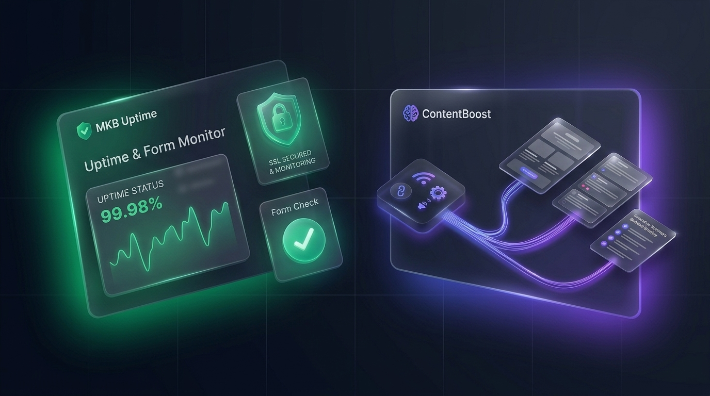
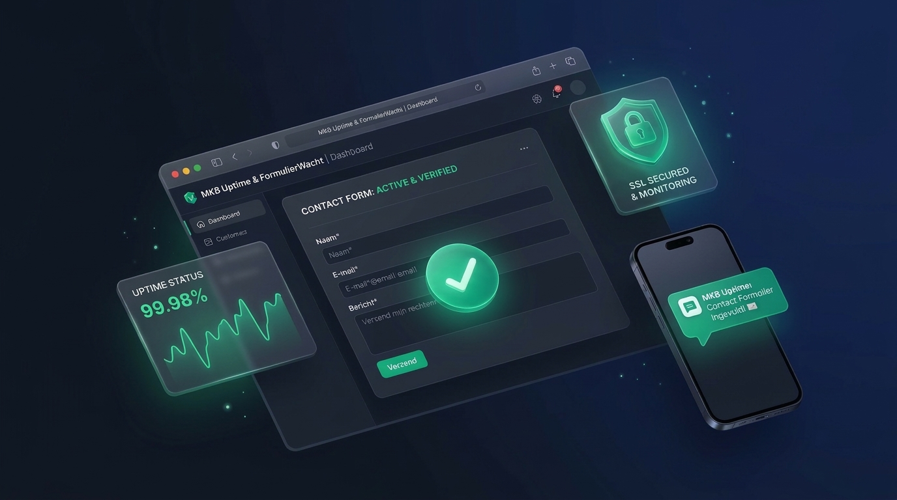
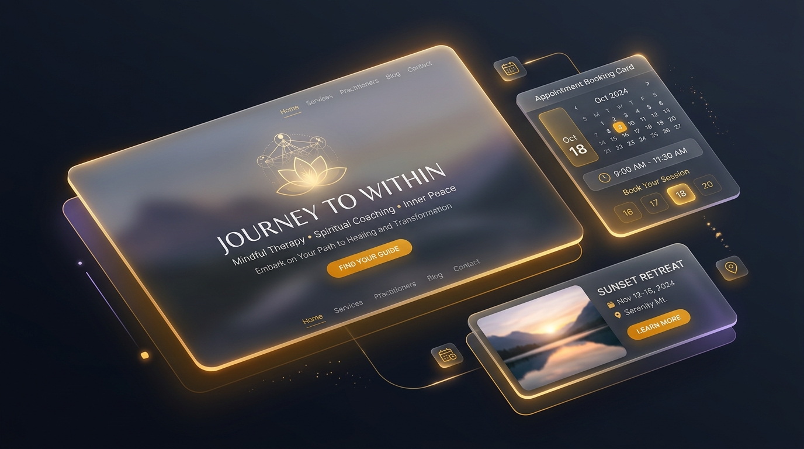
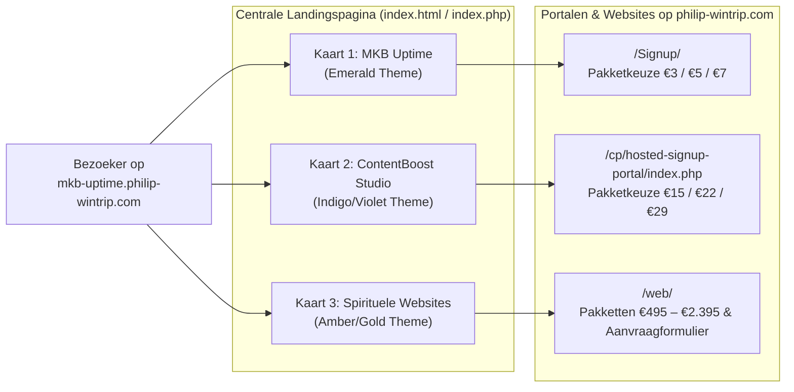

# Philip Wintrip — Centrale SaaS, Websites & Automatisering Landingspagina



> **Live Website:** [https://mkb-uptime.philip-wintrip.com/](https://mkb-uptime.philip-wintrip.com/)

De centrale, professionele dark-mode landingspagina voor de online diensten en zelfbedienings-SaaS portalen van **Philip Wintrip**. Bezoekers kiezen vanaf één overzichtelijke hub direct tussen:
1. **MKB Uptime & FormulierWacht** — 24/7 website-, SSL- en contactformulier-bewaking (`emerald` thema)
2. **ContentBoost Studio** — Automatische content-repurposing naar nieuwsbrieven en LinkedIn-reeksen (`indigo/violet` thema)
3. **Websites voor het Spiritueel Vlak** — Rustige, vertrouwenwekkende maatwerk websites voor therapeuten, coaches, yogadocenten, astrologen en retreats (`amber/gold` thema)

---

## 🚀 Gekoppelde Diensten & Portalen

<table>
  <tr>
    <td width="33%" valign="top">
      <a href="https://philip-wintrip.com/Signup/">
        
      </a>
      <h3>1. MKB Uptime &amp; Formulier Bot</h3>
      <p>Voorkom gemiste leads en offertes door een kapot contactformulier of verlopen SSL-certificaat na een plugin-update.</p>
      <ul>
        <li><strong>Elke 60 sec.:</strong> HTTP-status, laadtijd, SSL &amp; verplichte kernwoorden-check.</li>
        <li><strong>Formulier-bewaking:</strong> Elke minuut DOM-check + elke 15 min echte Chromium browser-check (Playwright).</li>
        <li><strong>Directe Alerts:</strong> E-mail, Telegram &amp; <strong>WhatsApp</strong>.</li>
        <li><strong>Pakketten:</strong> Basis (€ 3/mnd) · Pro Formulier (€ 5/mnd) · Compleet + WA (€ 7/mnd).</li>
      </ul>
      <p><a href="https://philip-wintrip.com/Signup/"><strong>→ Open MKB Uptime Portaal</strong></a></p>
    </td>
    <td width="33%" valign="top">
      <a href="https://philip-wintrip.com/cp/hosted-signup-portal/index.php">
        
      </a>
      <h3>2. ContentBoost Studio</h3>
      <p>Lever één URL, RSS-feed of ruwe tekstnotitie aan en ontvang direct je nieuwsbrief en LinkedIn-weekplanning in je eigen Tone-of-Voice.</p>
      <ul>
        <li><strong>Concept-Nieuwsbrief:</strong> 3 onderwerpregels, intro, kerninzichten &amp; vaste Call-to-Action.</li>
        <li><strong>3x LinkedIn-Reeks:</strong> Dinsdag (Hook), Donderdag (Stap-voor-Stap) &amp; Vrijdag (Verhaal &amp; Discussie).</li>
        <li><strong>Samenvattingen:</strong> Executive Summary (TL;DR) + 5 Key Takeaways + RSS-watchers.</li>
        <li><strong>Pakketten:</strong> Solo (€ 15/mnd) · Pro Creator (€ 22/mnd) · Agency (€ 29/mnd).</li>
      </ul>
      <p><a href="https://philip-wintrip.com/cp/hosted-signup-portal/index.php"><strong>→ Open ContentBoost Portaal</strong></a></p>
    </td>
    <td width="33%" valign="top">
      <a href="https://philip-wintrip.com/web/">
        
      </a>
      <h3>3. Websites voor het Spiritueel Vlak</h3>
      <p>Een website die ademt en vertrouwen uitstraalt. Speciaal voor therapeuten, coaches, yogadocenten, astrologen en retreat-organisaties.</p>
      <ul>
        <li><strong>Op maat gemaakt:</strong> Aansluitend bij jouw taal, kleuren en rustige uitstraling.</li>
        <li><strong>Compleet:</strong> Afsprakenplanner, online inschrijving, CMS, cursusmodule of webshop.</li>
        <li><strong>Flexibel onderhoud:</strong> Onderhoudsabonnement optioneel vanaf € 0 / maand.</li>
        <li><strong>Pakketten:</strong> Essentieel (€ 495) · Helder (€ 895) · Uitgelicht (€ 1.595) · Maatwerk (v.a. € 2.395).</li>
      </ul>
      <p><a href="https://philip-wintrip.com/web/"><strong>→ Bekijk Websites &amp; Pakketten</strong></a></p>
    </td>
  </tr>
</table>

---

## 🏗️ Architectuur & Gebruikersflow



---

## 📁 Projectstructuur

```text
landingspagina/
├── index.html                        # Centrale landingspagina (HTML5 + Tailwind CSS)
├── index.php                         # Identieke PHP-entrypoint voor directe webhost-plaatsing
├── assets/
│   ├── favicon.svg                   # Vector favicon (PW monogram in Emerald/Indigo/Amber)
│   ├── hero-banner.png               # Overzichtsbanner (3 producten) voor GitHub README
│   ├── hero-bg.png                   # Gelaagde dark-slate infrastructuur achtergrond
│   ├── mkb-uptime-preview.png        # 3D UI-visual voor MKB Uptime & FormulierWacht
│   ├── contentboost-preview.png      # 3D UI-visual voor ContentBoost Studio
│   └── web-spiritueel-preview.png    # 3D UI-visual voor Websites voor het Spiritueel Vlak
└── README.md                         # Projectdocumentatie
```

---

## 🌐 Live Omgeving

- **Centrale Landingspagina:** [https://mkb-uptime.philip-wintrip.com/](https://mkb-uptime.philip-wintrip.com/)
- **MKB Uptime Aanmeldportaal:** [https://philip-wintrip.com/Signup/](https://philip-wintrip.com/Signup/)
- **ContentBoost Studio Aanmeldportaal:** [https://philip-wintrip.com/cp/hosted-signup-portal/index.php](https://philip-wintrip.com/cp/hosted-signup-portal/index.php)
- **Websites voor het Spiritueel Vlak:** [https://philip-wintrip.com/web/](https://philip-wintrip.com/web/)
