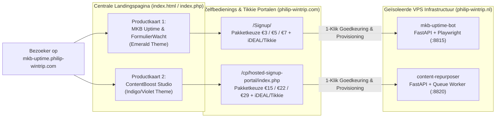

# Philip Wintrip — Centrale SaaS & Automatisering Landingspagina


> **Live Website:** [https://mkb-uptime.philip-wintrip.com/](https://mkb-uptime.philip-wintrip.com/)

De centrale, professionele dark-mode landingspagina voor de zelfbedienings-SaaS portalen van **Philip Wintrip**. Bezoekers kiezen vanaf één overzichtelijke hub direct tussen **MKB Uptime & FormulierWacht** (24/7 website-, SSL- en contactformulier-bewaking) en **ContentBoost Studio** (automatische content-repurposing naar nieuwsbrieven en LinkedIn-reeksen).

---

## 🚀 Gekoppelde SaaS-Producten

<table>
  <tr>
    <td width="50%" valign="top">
      <a href="https://philip-wintrip.com/Signup/">
        
      </a>
      <h3>1. MKB Uptime &amp; Formulier Bot</h3>
      <p>Voorkom gemiste leads en offertes door een kapot contactformulier of verlopen SSL-certificaat na een plugin-update.</p>
      <ul>
        <li><strong>Elke 60 seconden:</strong> HTTP-status, laadtijd, SSL-certificaat &amp; verplichte kernwoorden-check.</li>
        <li><strong>Formulier-bewaking:</strong> Elke minuut HTML/DOM-check + elke 15 minuten een echte headless Chromium browser-check (Playwright).</li>
        <li><strong>Directe Alerts:</strong> Storings- en herstelmeldingen via E-mail, Telegram en <strong>WhatsApp</strong>.</li>
        <li><strong>Pakketten:</strong> Basis (€ 3/mnd) · Pro Formulier (€ 5/mnd) · Compleet + WhatsApp (€ 7/mnd).</li>
      </ul>
      <p><a href="https://philip-wintrip.com/Signup/"><strong>→ Open MKB Uptime Aanmeldportaal</strong></a></p>
    </td>
    <td width="50%" valign="top">
      <a href="https://philip-wintrip.com/cp/hosted-signup-portal/index.php">
        
      </a>
      <h3>2. ContentBoost Studio</h3>
      <p>Lever één URL, RSS-feed of ruwe tekstnotitie aan en ontvang direct je nieuwsbrief en LinkedIn-weekplanning in je eigen Tone-of-Voice.</p>
      <ul>
        <li><strong>Concept-Nieuwsbrief:</strong> 3 onderwerpregels, preview-tekst, persoonlijke intro, kerninzichten &amp; vaste Call-to-Action.</li>
        <li><strong>3x LinkedIn-Reeks:</strong> Dinsdag (Hook &amp; Thought Leadership), Donderdag (Stap-voor-Stap Lijst) &amp; Vrijdag (Persoonlijk Verhaal &amp; Discussie).</li>
        <li><strong>Samenvattingen:</strong> Executive Summary (TL;DR) + 5 Key Takeaway bullets + automatische RSS-watchers.</li>
        <li><strong>Pakketten:</strong> Solo Maker (€ 15/mnd) · Pro Creator (€ 22/mnd) · Bureau / Agency (€ 29/mnd).</li>
      </ul>
      <p><a href="https://philip-wintrip.com/cp/hosted-signup-portal/index.php"><strong>→ Open ContentBoost Studio Aanmeldportaal</strong></a></p>
    </td>
  </tr>
</table>

---

## 🏗️ Architectuur & Gebruikersflow



---

## ✨ Design & Technische Kenmerken

- **Stijlgetrouw & Verfijnd:** Gebouwd in dezelfde `slate-950` dark-mode designtaal als beide achterliggende portalen, met `emerald-400/500` accenten voor **MKB Uptime** en `indigo-500`/`violet-600` accenten voor **ContentBoost Studio**.
- **Gelaagde Professionele Achtergrond:** Combineert een op maat gegenereerde dark-slate digitale infrastructuur-achtergrond (`assets/hero-bg.png`) met subtiele ambient lichtaccenten en een technisch CSS-grid.
- **Direct Inzetbaar (`.html` én `.php`):** Zowel `index.html` als `index.php` zijn identiek meegeleverd, zodat elke Apache/Nginx vhost-configuratie op [https://mkb-uptime.philip-wintrip.com/](https://mkb-uptime.philip-wintrip.com/) direct werkt zonder extra build-stap.

---

## 📁 Projectstructuur

```text
landingspagina/
├── index.html                      # Centrale landingspagina (HTML5 + Tailwind CSS)
├── index.php                       # Identieke PHP-entrypoint voor directe webhost-plaatsing
├── assets/
│   ├── hero-banner.png             # Overzichtsbanner voor GitHub README
│   ├── hero-bg.png                 # Gelaagde dark-slate infrastructuur achtergrond
│   ├── mkb-uptime-preview.png      # 3D UI-visual voor MKB Uptime & FormulierWacht
│   └── contentboost-preview.png    # 3D UI-visual voor ContentBoost Studio
└── README.md                       # Projectdocumentatie
```

---

## 🌐 Live Omgeving

- **Landingspagina:** [https://mkb-uptime.philip-wintrip.com/](https://mkb-uptime.philip-wintrip.com/)
- **MKB Uptime Aanmeldportaal:** [https://philip-wintrip.com/Signup/](https://philip-wintrip.com/Signup/)
- **ContentBoost Studio Aanmeldportaal:** [https://philip-wintrip.com/cp/hosted-signup-portal/index.php](https://philip-wintrip.com/cp/hosted-signup-portal/index.php)
